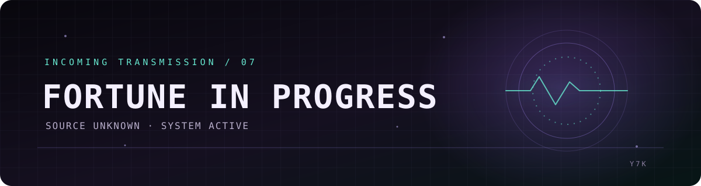

### `yapex7k`

**MACHINE ENGINEER**　◈　**SOFTWARE DEVELOPER**

*I read the hidden logic of machines — and leave my own signals in code.*

*The work stays hidden. You’ll see it when I’m rich.*

 

━━━━━━━━━━━━━━━━━━━━━━━━━━━━━━━━━━━━━━━━━━━━

### `SIGNAL CARRIERS`

`JAVASCRIPT`　·　`TYPESCRIPT`　·　`PYTHON`　·　`JAVA`　·　`C`　·　`C++`  
`C#`　·　`GO`　·　`RUST`　·　`PHP`　·　`RUBY`　·　`KOTLIN`  
`SWIFT`　·　`HTML`　·　`CSS`　·　`SQL`　·　`BASH`

 

<table>
<tr>
<td align="center"><b>FIELD</b> Mechanical systems</td>
<td align="center"><b>MEDIUM</b> Code &amp; motion</td>
<td align="center"><b>STATUS</b> Active</td>
</tr>
</table>

### `TRANSMISSION // 07`

Most things are made twice: 
first in the mind, then in the world.

 

`PROJECTS`　**CLASSIFIED**　　`LOCATION`　**UNKNOWN**

━━━━━━━━━━━━━━━━━━━━━━━━━━━━━━━━━━━━━━━━━━━━

If you found this, you were meant to.

